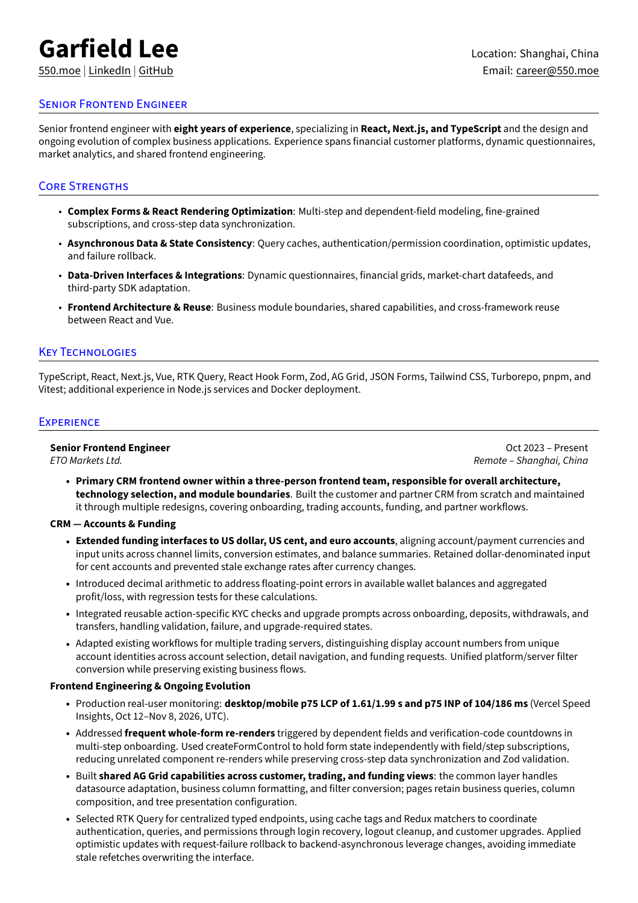
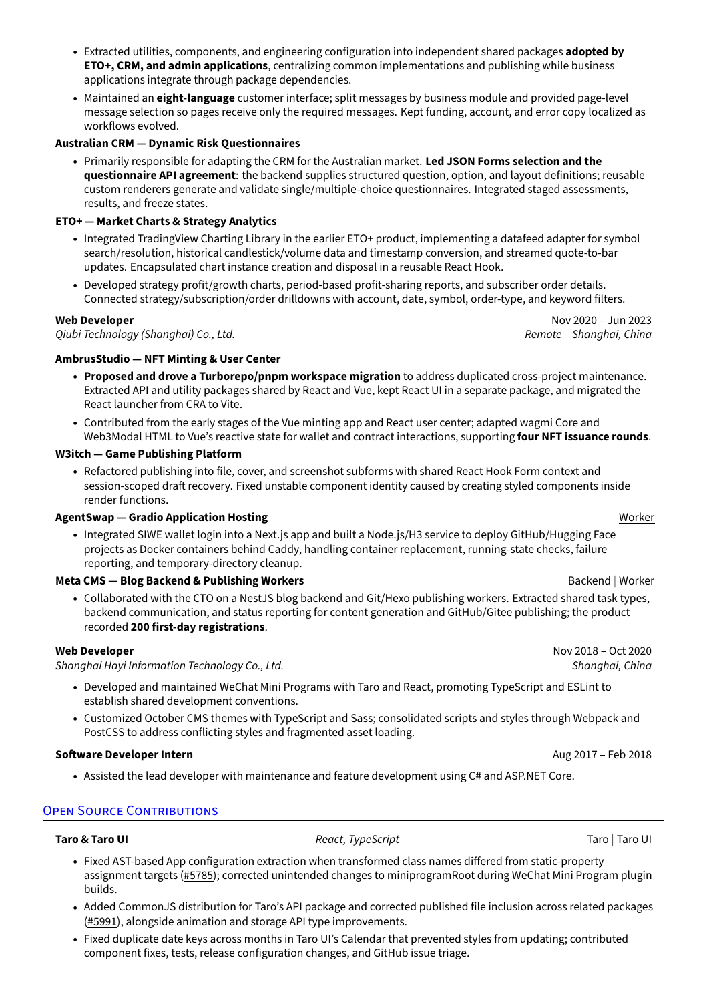

# [Garfield Lee's Resume](resume.pdf)





## Build the Chinese version

Use `resume.zh-cn.tex` as the main document and compile with **XeLaTeX**. In Overleaf, open **Menu → Settings → Compiler**, select **XeLaTeX**, then set `resume.zh-cn.tex` as the main document. The source uses TeX Live's Fandol fonts, so no extra font files or compatibility packages need to be uploaded.

For a local build with TeX Live 2026, run:

```text
xelatex resume.zh-cn.tex
```
